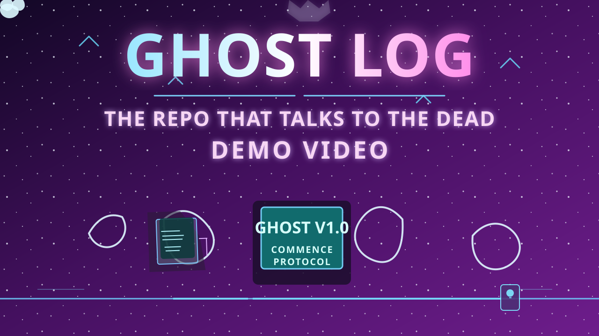

# 👻 GhostLog — The Repo That Talks to the Dead

A Hacktoberfest 2026 "Ghost in the Machine" submission. GhostLog reads a
local git repository's commit history and asks a **locally-running
open-weight model** (Gemma, via Ollama) to turn it into a short
Día de los Muertos–style ghost story — leaning extra hard on commits
made during the "witching hour" (midnight–4am).

Everything runs on your machine. No commit messages, authors, or code
are ever sent to an external API.

## 🎥 Demo video

See GhostLog in action and watch it turn a repository's commit history
into a spooky, story-driven ghost tale powered by a local Ollama model.

[](https://youtu.be/4eQHvKpeTqM)

Click the thumbnail above to watch the full demo on YouTube.

## 1. Install Ollama (one-time, ~2 min)

Download from **https://ollama.com/download** (macOS/Windows/Linux,
free). Then pull an open-weight Gemma model:

```bash
ollama pull gemma3:4b
```

(If your laptop is light on RAM, use `gemma2:2b` instead — it's smaller
and still works fine. Just change the model name in the app's sidebar
to match whatever you pulled.)

Ollama runs as a background service after install, but if the app
can't reach it, start it manually in a terminal:

```bash
ollama serve
```

## 2. Install project dependencies

```bash
cd ghostlog
python3 -m venv .venv
source .venv/bin/activate   # Windows: .venv\Scripts\activate
pip install -r requirements.txt
```

## 3. Run it

```bash
streamlit run app.py
```

This opens the app in your browser (usually `http://localhost:8501`).
Paste the path to any local git repo (your own project, or even this
`ghostlog` folder itself — run `git init && git add . && git commit -m
"init"` in it first if you haven't), hit **Summon the Ghosts**, and
read your spirits' story.

## Why a local, open-weight model instead of a closed API?

- **Works with zero internet** once the model is pulled — handy for a
  repo you don't want leaving your machine, or for a demo with flaky
  wifi.
- **Nothing proprietary leaves your laptop.** Commit messages and
  author names can be sensitive for a private codebase; a closed API
  would mean shipping that history to a third party.
- **Free, no API key, no rate limit.** Swapping `gemma3:4b` for any
  other Ollama-hosted open-weight model (Llama 3, Mistral, etc.) is a
  one-line change — no code rewrite, no new account.

## Project structure

```
ghostlog/
├── app.py            # Streamlit UI
├── ghost_story.py     # git log parsing + prompt building + Ollama call
├── requirements.txt
└── README.md
```

## Extending it in Antigravity

This whole repo is ready to open directly in
[Google Antigravity](https://antigravity.google) (free, agentic IDE).
A few prompts that work well once it's open:

- *"Add a dark/light theme toggle to the Streamlit sidebar."*
- *"Add a second mode that reads a plain .txt log file instead of a
  git repo, for the smart-home-sensor-log idea from the challenge
  prompt."*
- *"Write a pytest suite for ghost_story.py covering witching-hour
  detection and the error paths."*
- *"Dockerize this so it's a single `docker run` to try."*

Let Antigravity plan and execute each change, then review its diff
before accepting — treat it like a fast junior collaborator, not
autopilot.

## Submitting to Hacktoberfest

See `SUBMISSION_DRAFT.md` in this folder for a pre-filled DEV.to post
using the official Week 4 template — just drop in your GitHub link,
screenshots, and a short demo clip/GIF.
